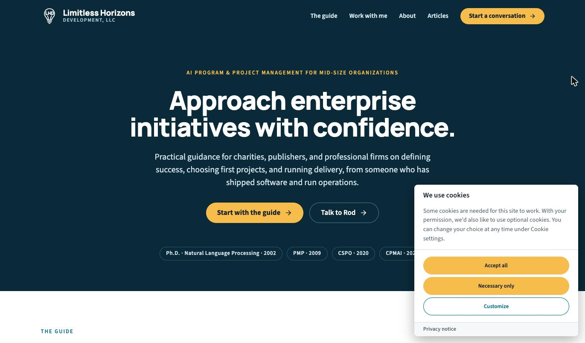
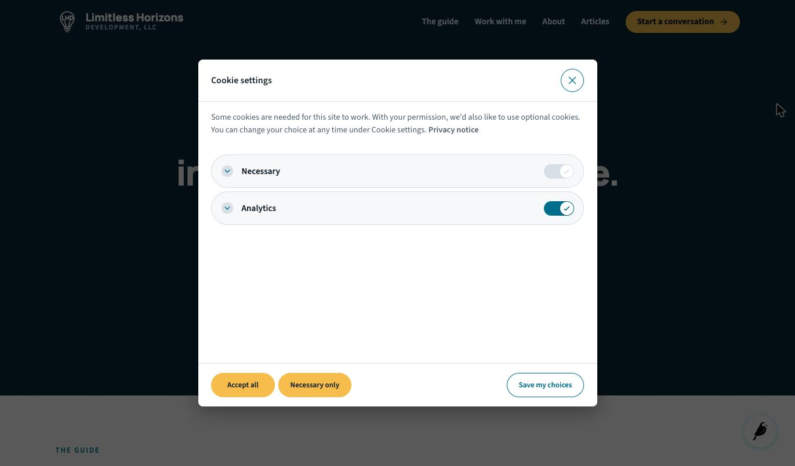
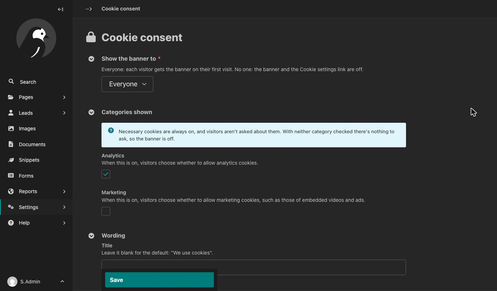
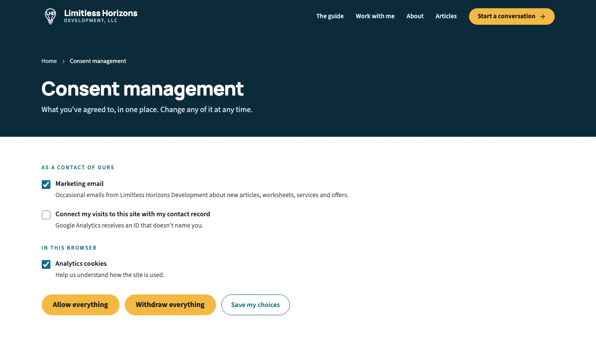

# Wagtail cookie consent

A cookie consent banner for Wagtail. Our ultimate goal is everything you need to do to set up the banner, you do through the Wagtail admin.

Claude Code was used with oversight by the maintainer.

## Summary of Purpose

“Wagtail cookie consent” adds a cookie consent banner to a Wagtail site, and tells the rest of the page what each visitor chose. Who sees the banner, which categories it asks about and what it says are set in the admin UI.

The banner is [vanilla-cookieconsent](https://github.com/orestbida/cookieconsent), which ships inside the package, so nothing loads from a third party.

It doesn't block or load other scripts for you, and it doesn't delete cookies another script has set: your analytics or other code acts on the visitor's choice (see [Acting on the choice](#acting-on-the-choice)). It also doesn't decide what your site has to ask about; check the rules that apply to your site.

## Progress so far

- A banner on a visitor's first visit, with **Accept all**, **Necessary only** and **Customize**. Accepting and refusing are equally easy, and the category switches start off.
- The choice is remembered for 182 days, in a cookie on the visitor's device.
- A **Cookie settings** link reopens the choices, so a visitor can change or withdraw them at any time.
- The choice is announced to the page when it's made, when it changes, and on each later page load.
- A page of your own can [show and change the choice](#a-page-of-your-own).
- The banner is kept out of preview views automatically (non-configurable).
- Settings available under Settings → Cookie consent, per the table below.

The banner on a visitor's first visit, here with a site's own [colors](#colors):



The choices that **Customize** and the **Cookie settings** link open:



## Settings reference

Each site has its own settings, under **Settings → Cookie consent**.



| Setting | Default | What it does |
|---|---|---|
| Show the banner to | Everyone | **Everyone:** each visitor gets the banner on their first visit. **No one:** the banner and the Cookie settings link are off. |
| Categories shown: Analytics | On | When on, visitors choose whether to allow analytics cookies. |
| Categories shown: Marketing | On | When on, visitors choose whether to allow marketing cookies, such as those of embedded videos and ads. |
| Title | Blank | The banner's title. Blank means the default, “We use cookies”. |
| Text | Blank | The banner's text. Blank means the default text. |
| Privacy notice | None | A page the banner links to. |

Show only the categories your site uses. With neither checked there's nothing to ask, so the banner is off. Necessary cookies are always on, and visitors aren't asked about them.

When you change the categories shown, visitors who've already chosen are asked again.

## Requirements

- Wagtail 7.4, 8.0 or 8.1, with the [Python and Django versions](https://docs.wagtail.org/en/stable/releases/upgrading.html#compatible-django-python-versions) each of them supports
- `wagtail.contrib.settings`, which comes with Wagtail
- `django.template.context_processors.request` in your template settings. Wagtail's project template has it. Without it, the banner doesn't load.

## Installation

1. Install the package:

   ```sh
   pip install wagtail-cookie-consent
   ```

2. Add it to `INSTALLED_APPS`, with `wagtail.contrib.settings`:

   ```python
   INSTALLED_APPS = [
       # ...
       "wagtail.contrib.settings",
       "wagtail_cookie_consent",
       # ...
   ]
   ```

3. Create its table:

   ```sh
   python manage.py migrate
   ```

4. Add the banner to `<head>` in your base template, and the Cookie settings link where you want it, such as the footer:

   ```django
   
   <!doctype html>
   <html>
     <head>
       <meta charset="utf-8">
       
       ...
     </head>
     <body>
       ...
       <footer></footer>
     </body>
   </html>
   ```

5. In the Wagtail admin, go to **Settings → Cookie consent** and choose the categories your site uses.

The banner's scripts and stylesheet are among the package's static files. On a deployed site, run `collectstatic` after you install or upgrade the package, as for any app's static files.

## Usage

### The Cookie settings link

`` renders a button that reopens the visitor's choices. Give it your own label and HTML attributes:

```django

```

It has to come from this tag, or carry the same `data-cc="show-preferencesModal"` attribute, so it can't be an ordinary link an editor adds in the CMS. When the banner is off, the tag renders nothing.

### Acting on the choice

The banner announces the visitor's choice as a `wagtail-cookie-consent:change` event on `document`. Its `detail` has `true` or `false` for each category your site shows:

```js
document.addEventListener("wagtail-cookie-consent:change", (event) => {
  if (event.detail.analytics) {
    // The visitor allows analytics cookies.
  }
});
```

The event is sent when the visitor chooses, when they change their choice, and on each page load once a choice is stored. Before a visitor has chosen, no event is sent.

A stored choice is announced as soon as `` runs, and again once the banner has loaded. Add your listener before `` to hear it at the earliest, and make it safe to run more than once.

[wagtail-google-tag](https://github.com/Limitless-Horizons/wagtail-google-tag) listens for this event and updates Google's Consent Mode with it. Put `` before ``.

### A page of your own

A page of your own can show the visitor's choice and change it, for example a page where visitors manage everything they've agreed to. Here, a site's consent page shows the cookie choice as one checkbox among its own:



The banner's script defines `window.wagtailCookieConsent` for that:

```js
const consent = window.wagtailCookieConsent;

consent.categories; // The categories your site shows: ["analytics", "marketing"]
consent.get(); // { analytics: true, marketing: false }, or null before a choice

// Store a choice, as the banner would. Returns a promise.
consent.set({ analytics: false, marketing: false });

// Close the banner without a choice, on a page that asks in its own way.
consent.hideBanner();
```

`set()` announces the choice with the same `wagtail-cookie-consent:change` event, so everything that acts on the banner's choice acts on this one too. A category you leave out of `set()` is refused.

`window.wagtailCookieConsent` is there only when the banner is on. On such a page, give refusing the same prominence as agreeing, as the banner does.

### Colors

The banner's colors come from vanilla-cookieconsent's CSS variables. Set them in your own stylesheet, loaded after ``:

```css
#cc-main {
  --cc-bg: #ffffff;
  --cc-primary-color: #1f2937;
  --cc-btn-primary-bg: #0f766e;
  --cc-btn-primary-hover-bg: #115e59;
}
```

Its [documentation](https://cookieconsent.orestbida.com/advanced/ui-customization.html) lists the variables.

### Templates outside your base template

A template that doesn't extend your base template, such as a 404 page, needs the banner too:

```django

...

```

### Automated browsers

The banner hides itself from automated browsers and crawlers. To see it in browser tests, set this in your test settings:

```python
WAGTAIL_COOKIE_CONSENT_HIDE_FROM_BOTS = False
```

### Content Security Policy

Everything loads from your own static files: there are no third-party addresses and no inline scripts.

## Troubleshooting

- **No banner on the page:** “Show the banner to” is “No one”, no category is checked, the page is a preview, or `collectstatic` hasn't run. Run `python manage.py check` too: it warns when the request isn't in the template context.
- **No banner, though it's on:** you've already chosen. Use the Cookie settings link, or delete the `cc_cookie` cookie.
- **No banner in browser tests:** see [Automated browsers](#automated-browsers).

## Privacy notes

The visitor's choice is stored in a cookie named `cc_cookie` on their own device, for 182 days. It's a cookie of your own site. The package doesn't read it on the server, keeps no record of choices, and sends nothing to a third party.

## Links

- [Changelog](https://github.com/Limitless-Horizons/wagtail-cookie-consent/blob/main/CHANGELOG.md)
- [Contributing](https://github.com/Limitless-Horizons/wagtail-cookie-consent/blob/main/CONTRIBUTING.md)
- [Security policy](https://github.com/Limitless-Horizons/wagtail-cookie-consent/blob/main/SECURITY.md)
- [Agents](https://github.com/Limitless-Horizons/wagtail-cookie-consent/blob/main/AGENTS.md)

## License

BSD-3-Clause. See [LICENSE](https://github.com/Limitless-Horizons/wagtail-cookie-consent/blob/main/LICENSE).

vanilla-cookieconsent is included under the MIT license. Its license is in the package, next to its files.
