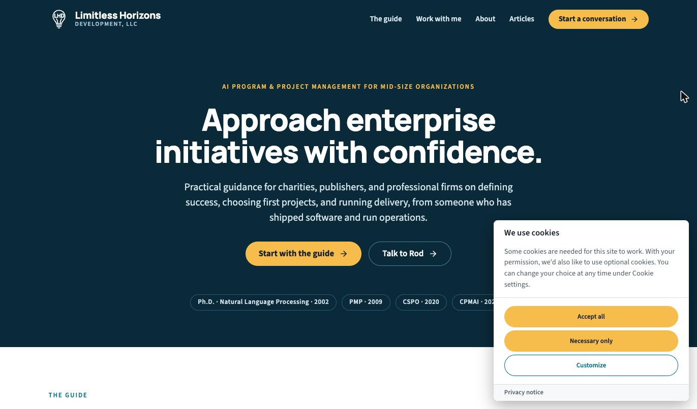
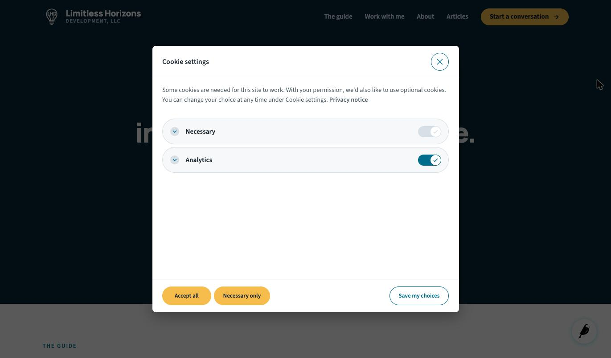

# Wagtail cookie consent

A cookie consent banner for Wagtail. Our ultimate goal is everything you need to do to set up the banner, you do through the Wagtail admin.

Claude Code was used with oversight by the maintainer.

## Summary of Purpose

“Wagtail cookie consent” adds a cookie consent banner to a Wagtail site, and tells the rest of the page what each visitor chose. Who sees the banner, which categories it asks about and what it says are set in the admin UI.

The banner is [vanilla-cookieconsent](https://github.com/orestbida/cookieconsent), which ships inside the package, so nothing loads from a third party.

It doesn't block or load other scripts for you, and it doesn't delete cookies another script has set: your analytics or other code acts on the visitor's choice (see [Act on the visitor's choice](https://github.com/Limitless-Horizons/wagtail-cookie-consent/blob/main/docs/how-to/act-on-the-choice.md)). It also doesn't decide what your site has to ask about; check the rules that apply to your site.

## Progress so far

- A banner on a visitor's first visit, with **Accept all**, **Necessary only** and **Customize**. Accepting and refusing are equally easy, and the category switches start off.
- The choice is remembered for 182 days, in a cookie on the visitor's device.
- A **Cookie settings** link reopens the choices, so a visitor can change or withdraw them at any time.
- The choice is announced to the page when it's made, when it changes, and on each later page load.
- A page of your own can [show and change the choice](https://github.com/Limitless-Horizons/wagtail-cookie-consent/blob/main/docs/how-to/build-your-own-consent-page.md).
- The banner is kept out of preview views automatically (non-configurable).
- Settings available under Settings → Cookie consent: see the [settings reference](https://github.com/Limitless-Horizons/wagtail-cookie-consent/blob/main/docs/reference/settings.md).

The banner on a visitor's first visit, here with a site's own [colors](https://github.com/Limitless-Horizons/wagtail-cookie-consent/blob/main/docs/how-to/change-the-colors.md):



The choices that **Customize** and the **Cookie settings** link open:



## Requirements

- Wagtail 7.4, 8.0 or 8.1, with the [Python and Django versions](https://docs.wagtail.org/en/stable/releases/upgrading.html#compatible-django-python-versions) each of them supports
- `wagtail.contrib.settings`, which comes with Wagtail
- `django.template.context_processors.request` in your template settings. Wagtail's project template has it. Without it, the banner doesn't load.

## Installation

1. Install the package:

   ```sh
   pip install wagtail-cookie-consent
   ```

2. Add it to `INSTALLED_APPS`, with `wagtail.contrib.settings`:

   ```python
   INSTALLED_APPS = [
       # ...
       "wagtail.contrib.settings",
       "wagtail_cookie_consent",
       # ...
   ]
   ```

3. Create its table:

   ```sh
   python manage.py migrate
   ```

4. Add the banner to `<head>` in your base template, and the Cookie settings link where you want it, such as the footer:

   ```django
   
   <!doctype html>
   <html>
     <head>
       <meta charset="utf-8">
       
       ...
     </head>
     <body>
       ...
       <footer></footer>
     </body>
   </html>
   ```

5. In the Wagtail admin, go to **Settings → Cookie consent** and choose the categories your site uses.

The banner's scripts and stylesheet are among the package's static files. On a deployed site, run `collectstatic` after you install or upgrade the package, as for any app's static files.

Then follow [Getting started](https://github.com/Limitless-Horizons/wagtail-cookie-consent/blob/main/docs/tutorial/getting-started.md) to see the banner and hear a visitor's choice.

## Documentation

The [documentation](https://github.com/Limitless-Horizons/wagtail-cookie-consent/blob/main/docs/README.md) is in four parts:

- **Tutorial:** [Getting started](https://github.com/Limitless-Horizons/wagtail-cookie-consent/blob/main/docs/tutorial/getting-started.md).
- **How-to guides:** [add the Cookie settings link](https://github.com/Limitless-Horizons/wagtail-cookie-consent/blob/main/docs/how-to/add-the-cookie-settings-link.md), [act on the visitor's choice](https://github.com/Limitless-Horizons/wagtail-cookie-consent/blob/main/docs/how-to/act-on-the-choice.md), [build your own consent page](https://github.com/Limitless-Horizons/wagtail-cookie-consent/blob/main/docs/how-to/build-your-own-consent-page.md), [change the colors](https://github.com/Limitless-Horizons/wagtail-cookie-consent/blob/main/docs/how-to/change-the-colors.md), [add the banner to other templates](https://github.com/Limitless-Horizons/wagtail-cookie-consent/blob/main/docs/how-to/add-the-banner-to-other-templates.md), [see the banner in browser tests](https://github.com/Limitless-Horizons/wagtail-cookie-consent/blob/main/docs/how-to/see-the-banner-in-browser-tests.md), and [troubleshoot](https://github.com/Limitless-Horizons/wagtail-cookie-consent/blob/main/docs/how-to/troubleshoot.md).
- **Reference:** [settings](https://github.com/Limitless-Horizons/wagtail-cookie-consent/blob/main/docs/reference/settings.md), [template tags](https://github.com/Limitless-Horizons/wagtail-cookie-consent/blob/main/docs/reference/template-tags.md), and the [script API](https://github.com/Limitless-Horizons/wagtail-cookie-consent/blob/main/docs/reference/script-api.md).
- **Explanation:** [how the banner works](https://github.com/Limitless-Horizons/wagtail-cookie-consent/blob/main/docs/explanation/how-the-banner-works.md), and [privacy](https://github.com/Limitless-Horizons/wagtail-cookie-consent/blob/main/docs/explanation/privacy.md).

## Links

- [Changelog](https://github.com/Limitless-Horizons/wagtail-cookie-consent/blob/main/CHANGELOG.md)
- [Contributing](https://github.com/Limitless-Horizons/wagtail-cookie-consent/blob/main/CONTRIBUTING.md)
- [Security policy](https://github.com/Limitless-Horizons/wagtail-cookie-consent/blob/main/SECURITY.md)
- [Agents](https://github.com/Limitless-Horizons/wagtail-cookie-consent/blob/main/AGENTS.md)

## License

BSD-3-Clause. See [LICENSE](https://github.com/Limitless-Horizons/wagtail-cookie-consent/blob/main/LICENSE).

vanilla-cookieconsent is included under the MIT license. Its license is in the package, next to its files.
