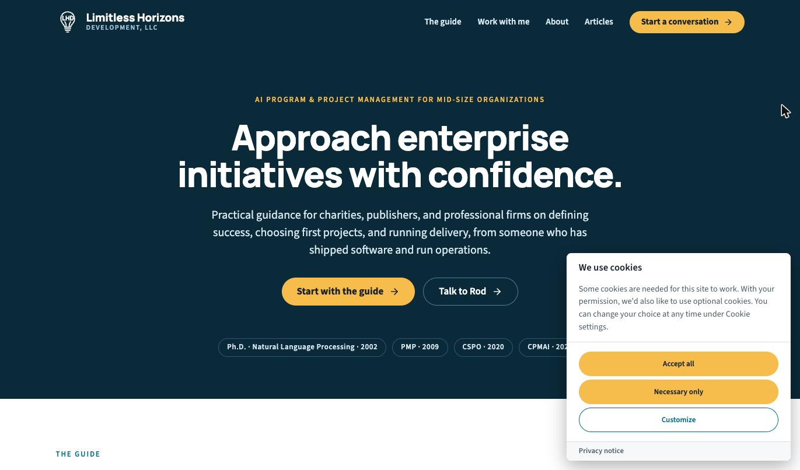
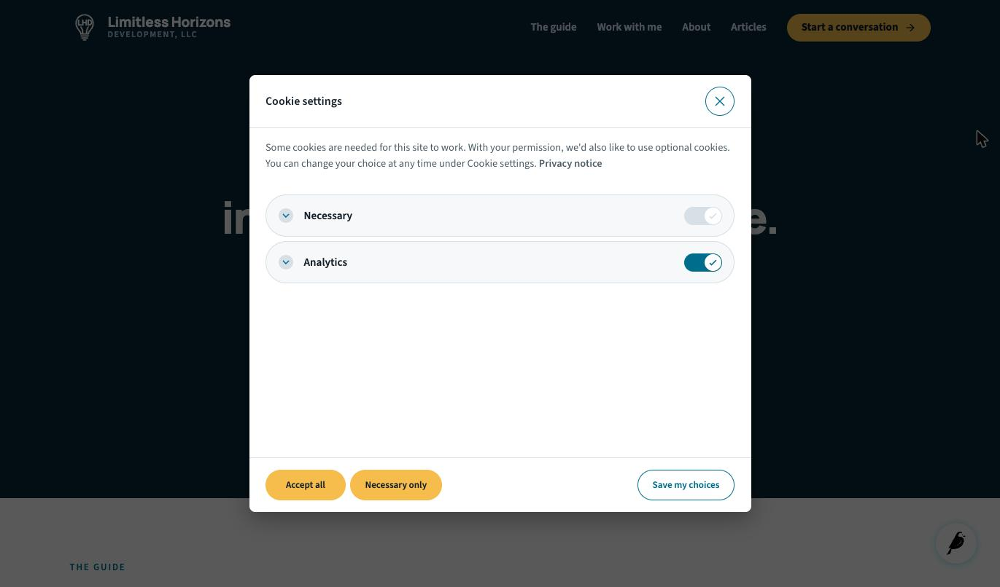

# How the banner works

## What it does, and what it leaves to you

The banner is [vanilla-cookieconsent](https://github.com/orestbida/cookieconsent), which ships inside the package, so nothing loads from a third party.

It doesn't block or load other scripts for you, and it doesn't delete cookies another script has set: your analytics or other code acts on the visitor's choice (see [Acting on the choice](../how-to/act-on-the-choice.md)). It also doesn't decide what your site has to ask about; check the rules that apply to your site.

## What a visitor sees

The banner on a visitor's first visit, here with a site's own [colors](../how-to/change-the-colors.md):

The choices that **Customize** and the **Cookie settings** link open:

A visitor's first visit shows the banner, with **Accept all**, **Necessary only** and **Customize**. Accepting and refusing are equally easy, and the category switches start off. The choice is remembered for 182 days, and the **Cookie settings** link reopens it, so a visitor can change or withdraw it at any time. When you change the categories shown, visitors who've already chosen are asked again.

The banner is kept out of Wagtail's preview views, and hides itself from automated browsers and crawlers.

## How the rest of the page learns the choice

The choice is announced to the page when it's made, when it changes, and on each later page load: see [Act on the visitor's choice](../how-to/act-on-the-choice.md).

## Content Security Policy

Everything loads from your own static files: there are no third-party addresses and no inline scripts.
