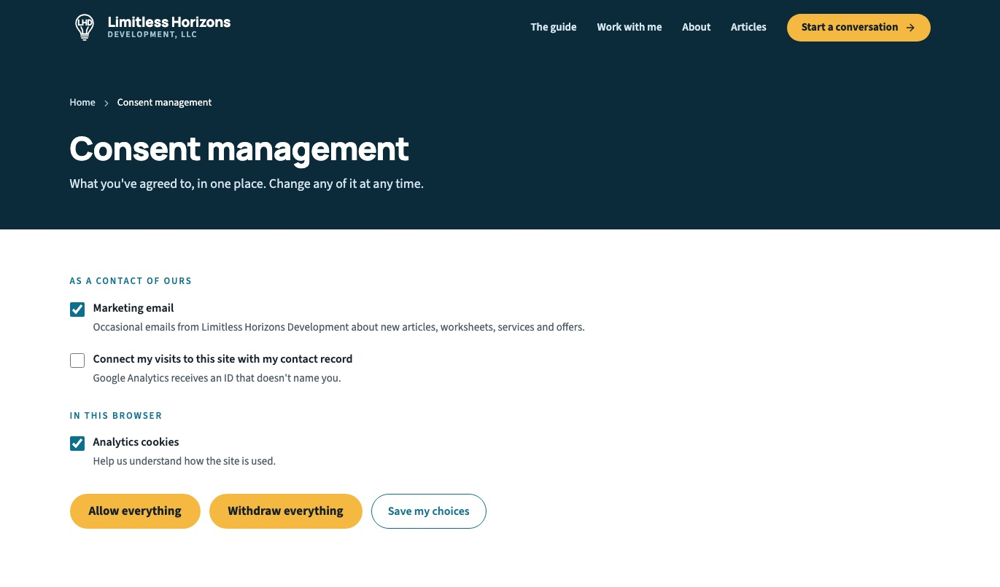

# Build your own consent page

A page of your own can show the visitor's choice and change it, for example a page where visitors manage everything they've agreed to. Here, a site's consent page shows the cookie choice as one checkbox among its own:



The banner's script defines `window.wagtailCookieConsent` for that:

```js
const consent = window.wagtailCookieConsent;

consent.categories; // The categories your site shows: ["analytics", "marketing"]
consent.get(); // { analytics: true, marketing: false }, or null before a choice

// Store a choice, as the banner would. Returns a promise.
consent.set({ analytics: false, marketing: false });

// Close the banner without a choice, on a page that asks in its own way.
consent.hideBanner();
```

`set()` announces the choice with the same `wagtail-cookie-consent:change` event, so everything that acts on the banner's choice acts on this one too. A category you leave out of `set()` is refused.

`window.wagtailCookieConsent` is there only when the banner is on. On such a page, give refusing the same prominence as agreeing, as the banner does.

The members of `window.wagtailCookieConsent` are listed in the [script API reference](../reference/script-api.md).
