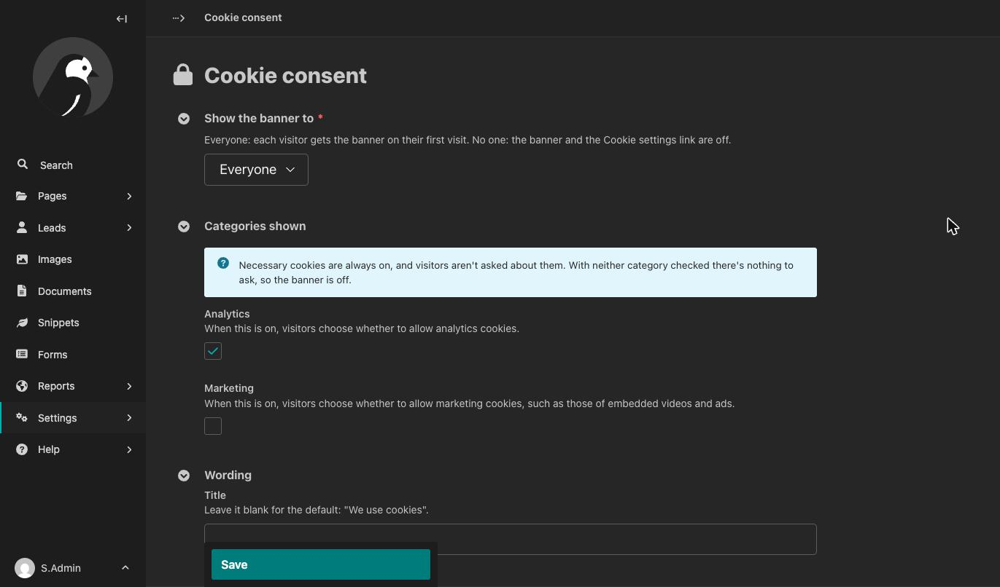

# Settings

Each site has its own settings, under **Settings → Cookie consent**.

| Setting | Default | What it does |
|---|---|---|
| Show the banner to | Everyone | **Everyone:** each visitor gets the banner on their first visit. **No one:** the banner and the Cookie settings link are off. |
| Categories shown: Analytics | On | When on, visitors choose whether to allow analytics cookies. |
| Categories shown: Marketing | On | When on, visitors choose whether to allow marketing cookies, such as those of embedded videos and ads. |
| Title | Blank | The banner's title. Blank means the default, “We use cookies”. |
| Text | Blank | The banner's text. Blank means the default text. |
| Privacy notice | None | A page the banner links to. |

Show only the categories your site uses. With neither checked there's nothing to ask, so the banner is off. Necessary cookies are always on, and visitors aren't asked about them.

When you change the categories shown, visitors who've already chosen are asked again.

## Permission

Wagtail registers one permission for this screen: change (`wagtail_cookie_consent.change_cookieconsentsettings`). Give it to a group under **Settings → Groups**. A user without it doesn't see **Settings → Cookie consent**. Administrators always have it.

## Django settings

| Setting | Default | What it does |
|---|---|---|
| `WAGTAIL_COOKIE_CONSENT_HIDE_FROM_BOTS` | `True` | The banner hides itself from automated browsers and crawlers. Set it to `False` to see the banner in browser tests: see [See the banner in browser tests](../how-to/see-the-banner-in-browser-tests.md). |
